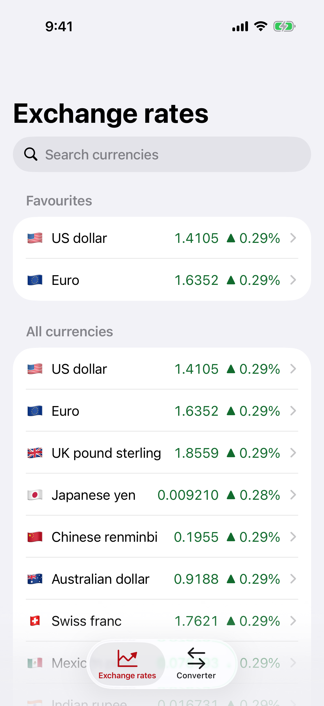
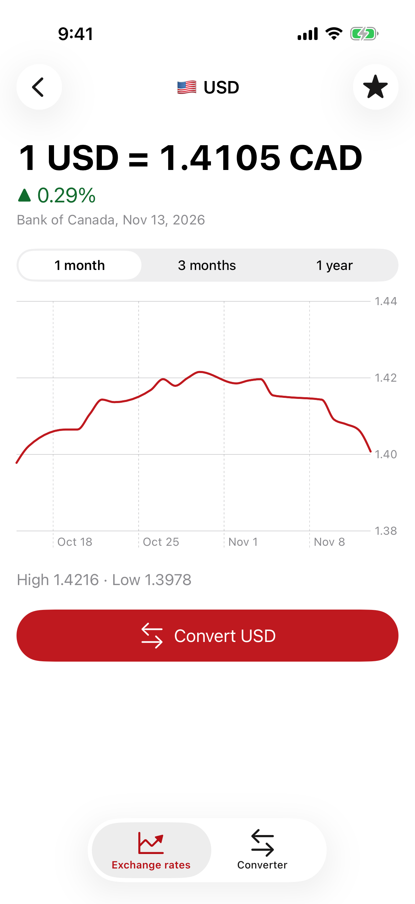
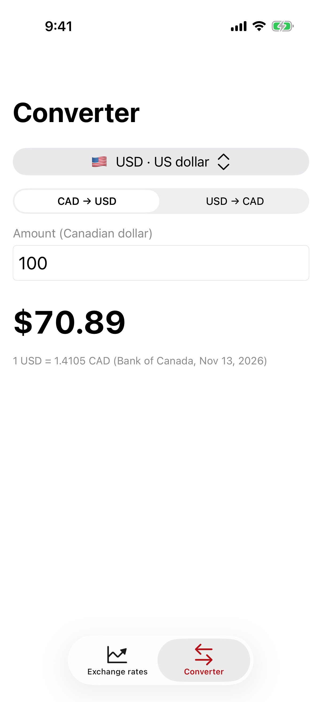
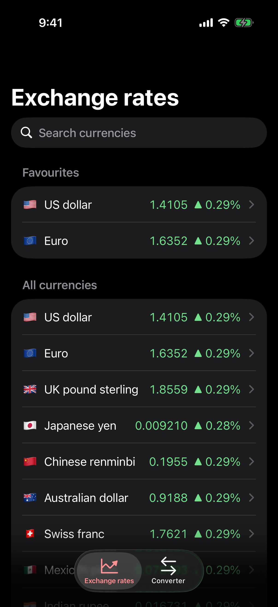

# Loonie Rates 🍁

A UIKit iPhone app that shows the **Bank of Canada's daily exchange rates**, charts them and
converts amounts to and from Canadian dollars, in **English and French**.

<!-- auto:demo -->

<!-- /auto:demo -->

<!-- auto:gallery -->
| Rates | Detail and chart | Converter | Dark Mode |
|---|---|---|---|
|  |  |  |  |
<!-- /auto:gallery -->

## Features
- Live rates for 12 currencies from the Bank of Canada's public Valet API, with daily change
- Favourites (swipe a row), search, pull to refresh
- A chart for 1 month, 3 months or 1 year (Swift Charts inside UIKit)
- A converter that works both ways, rounds to the cent and reads amounts typed the French way
- Works offline with the last saved rates and says when they were saved
- VoiceOver, Dynamic Type up to the largest size, Dark Mode, full French translation

## Tech
| Area | Used |
|---|---|
| UI | UIKit in code (no storyboards), Auto Layout, compositional list layout, diffable data source |
| Interop | SwiftUI + Swift Charts in `UIHostingController`; an Objective-C class through a bridging header |
| Architecture | MVVM + Coordinator; logic in the `RatesKit` Swift package |
| Networking | `URLSession` behind a protocol, async/await, typed errors, offline cache (actor) |
| Tests | XCTest: package tests (macOS + Linux), view model tests, UI tests in two languages, accessibility audit |
| CI | GitHub Actions: lint, build, test, 70% coverage gate; protected `main` |

## Run it (on a Mac)
```bash
brew install xcodegen
xcodegen generate
open LoonieRates.xcodeproj    # pick an iPhone simulator, press Cmd+R
```
No Mac? Every push is built and tested on GitHub's Macs: see the Actions tab.

## Coverage
<!-- auto:coverage -->
| Package | Line coverage | Lines | Gate |
|---|---|---|---|
| RatesKit | 82.5% | 360 | PASS (min 70%) |
<!-- /auto:coverage -->

## Docs
[Day 1](docs/day-1.md) · [Day 2](docs/day-2.md) · [Day 3](docs/day-3.md) · [Accessibility](docs/accessibility.md) · [Job requirements](docs/REQUIREMENTS.md)

Rates: [Bank of Canada](https://www.bankofcanada.ca/rates/exchange/), used under its [terms](https://www.bankofcanada.ca/terms/). Not financial advice.
