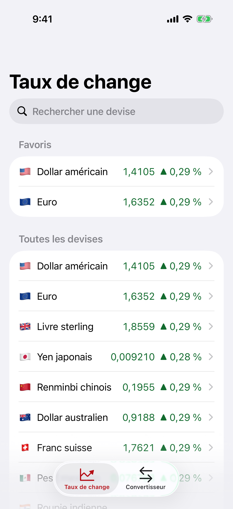
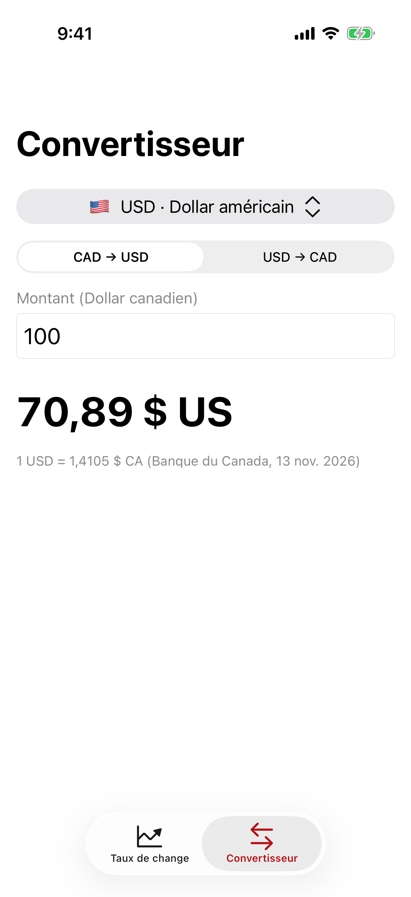
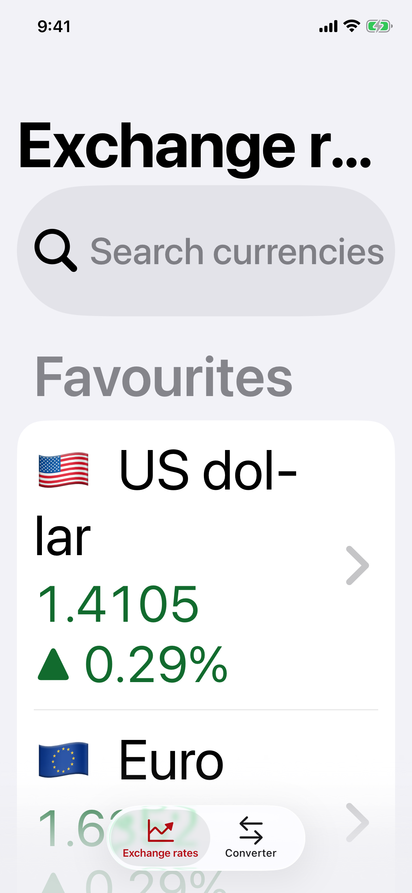
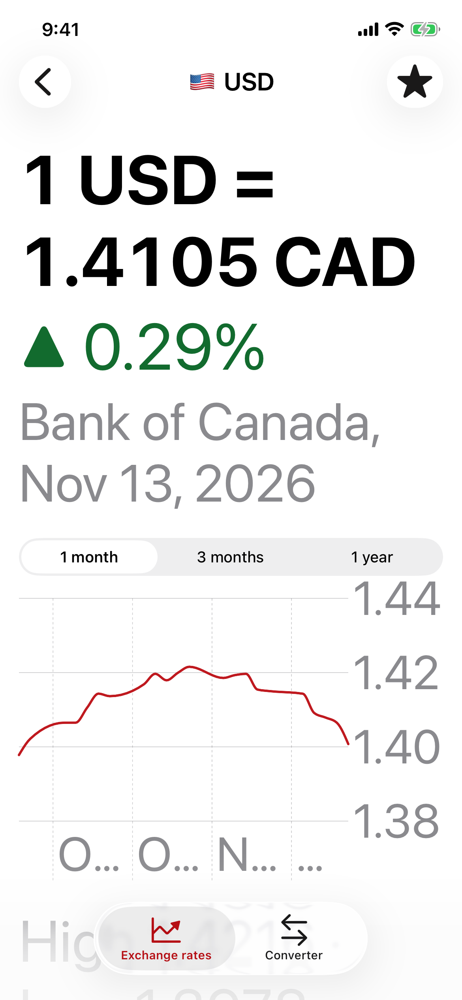
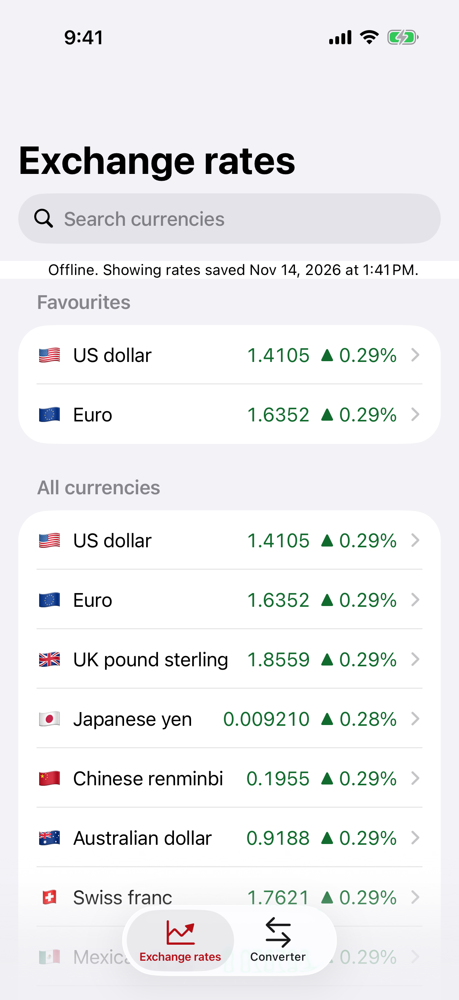

# Day 3: French, accessibility, UI tests and evidence

## Goal
Make the app usable by everyone in both of Canada's official languages, prove it with
automated tests, and lock `main` so nothing broken can be merged.

## French
- Every string lives in `App/Resources/en.lproj/Localizable.strings` and `fr.lproj/Localizable.strings` with the same keys.
- Numbers, money and dates use `NumberFormatter` and `DateFormatter` with the locale: `1.3978` becomes `1,3978` and `$139.78` becomes `139,78 $`.
- The converter reads amounts typed with a French decimal comma (`AmountParser`, Day 1).
- `testEverythingIsInFrench` launches the app with `-AppleLanguages (fr)` and checks titles and number format.

## UI tests
| Test | Proves |
|---|---|
| `testOpenRateChartAndConvert` | List, detail, range switch, convert, flip direction |
| `testSearchFindsTheYen` | Search filters the list |
| `testSwipeToFavourite` | Swipe action moves a currency into Favourites |
| `testOfflineShowsSavedRatesWithABanner` | Offline fallback and the banner |
| `testEverythingIsInFrench` | Translation and French number format |
| `AccessibilityAuditTests` | Xcode's accessibility audit on every screen |

## Screens
<!-- auto:screens-day3 -->
| French: rates | French: converter | Largest text: rates | Largest text: detail | Offline banner |
|---|---|---|---|---|
|  |  |  |  |  |
<!-- /auto:screens-day3 -->

## CI proof
<!-- auto:ci-proof -->
[This throwaway pull request](https://github.com/jamierowe15/loonie-rates/pull/4) added a deliberately failing test. CI went red and GitHub blocked the merge, so the PR was closed unmerged.
<!-- /auto:ci-proof -->

## Coverage
<!-- auto:coverage -->
| Package | Line coverage | Lines | Gate |
|---|---|---|---|
| RatesKit | 82.5% | 360 | PASS (min 70%) |
<!-- /auto:coverage -->

<!-- auto:run -->
Generated by [this Evidence workflow run](https://github.com/jamierowe15/loonie-rates/actions/runs/44253196375).
<!-- /auto:run -->
